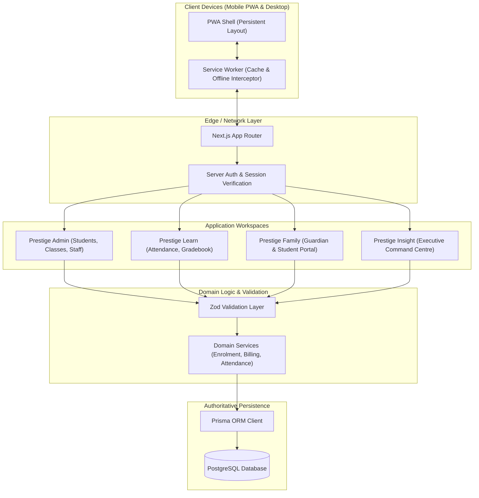

# System Architecture: Prestige ONE

**Project**: Prestige ONE Integrated Digital Ecosystem  
**Client**: Prestige School, Mozambique  
**Provider**: Flectēre (Private) Limited  
**Lead Architect**: Autonomous Full-Stack Engineering Team  
**Date**: October 2026  

---

## 1. Architectural Principles

1. **One Authoritative Database Record**: No split-brain state or unverified client-side stores. PostgreSQL is the single source of truth.
2. **Mobile-First Experience**: High-density, touch-friendly interfaces tailored for 375px–420px phone screens while gracefully scaling to desktop workstations.
3. **Persistent App Shell**: The global navigation, status headers, user identity controls, and notifications remain continuously mounted during internal route transitions.
4. **Resilient Network Layer**: Network-first / network-only for all dynamic and authenticated mutations; cache-first strictly for immutable versioned assets.
5. **Secure Multi-Tenant Boundaries**: Every database read and write verifies the institutional tenant and the user's role-and-relationship authorization scope.

---

## 2. Technology Stack Selection

```
┌─────────────────────────────────────────────────────────────┐
│                    CLIENT EXPERIENCES                       │
│  Next.js 15+ App Router, React 19, Tailwind CSS, Lucide    │
│  PWA: Service Worker, Web App Manifest, Offline Fallback    │
├─────────────────────────────────────────────────────────────┤
│                    APPLICATION CORE                         │
│  TypeScript (Strict Mode), Zod Validation, React Hook Form  │
│  Server Actions & Route Handlers, Custom Session Auth       │
├─────────────────────────────────────────────────────────────┤
│                    DATA ACCESS & STORAGE                    │
│  Prisma ORM, Native PostgreSQL Server                       │
│  Tenant Scoping & Foreign Key Constraints                   │
├─────────────────────────────────────────────────────────────┤
│                    VERIFICATION & CI                        │
│  Vitest (Unit/Schema Tests), Playwright (E2E Browser Tests) │
└─────────────────────────────────────────────────────────────┘
```

- **Framework**: Next.js App Router with TypeScript strict mode enabled (`"strict": true`, `"noImplicitAny": true`).
- **Styling**: Tailwind CSS with Flectēre design tokens (Navy, Crimson, Slate, Light, Gold, Green).
- **ORM & Database**: Prisma ORM connecting to native PostgreSQL with strict schema constraints, foreign keys, and indexes.
- **Authentication**: Session-based authentication using secure HTTP-only cookies, cryptographically salted passwords, and server-side authorization checks.
- **Form Handling & Validation**: Zod schemas for shared client and server validation; React Hook Form for interactive form state.
- **PWA Service Worker**: Custom service worker precaching the offline fallback page and versioned static assets, strictly isolating authenticated data.

---

## 3. High-Level System Architecture



---

## 4. Relational Data Architecture

The relational schema is designed to represent the core operational life of Prestige School while enforcing data integrity:

```mermaid
erDiagram
    INSTITUTION ||--o{ ACADEMIC_YEAR : configures
    INSTITUTION ||--o{ USER : employs_or_enrolls
    INSTITUTION ||--o{ STUDENT : educates
    INSTITUTION ||--o{ CLASS : organizes

    ACADEMIC_YEAR ||--o{ TERM : contains
    ACADEMIC_YEAR ||--o{ ENROLLMENT : applies_to

    USER ||--o{ AUDIT_LOG : initiates
    USER ||--o| GUARDIAN : extends_if_parent
    USER ||--o| STAFF : extends_if_staff

    STUDENT ||--o{ ENROLLMENT : undergoes
    CLASS ||--o{ ENROLLMENT : hosts
    CLASS ||--o{ ATTENDANCE_RECORD : tracks
    STUDENT ||--o{ ATTENDANCE_RECORD : attends

    GUARDIAN ||--o{ GUARDIAN_STUDENT : cares_for
    STUDENT ||--o{ GUARDIAN_STUDENT : cared_by

    STUDENT ||--o{ INVOICE : billed_to
    INVOICE ||--o{ PAYMENT : settles

    CLASS ||--o{ ASSESSMENT : administers
    ASSESSMENT ||--o{ ASSESSMENT_RESULT : records
    STUDENT ||--o{ ASSESSMENT_RESULT : earns
```

### Key Entities:
1. **Institution**: Multi-tenant anchor (name, code, country, currency).
2. **User**: Authentication principal (email, password hash, role: `DIRECTOR`, `ADMIN`, `TEACHER`, `FINANCE`, `GUARDIAN`, `STUDENT`).
3. **Student**: Master record (admission number, legal first/last name, DOB, gender, nationality, enrollment status).
4. **Guardian & GuardianStudent**: Verified parent/carer relations with explicit access flags (`hasCustody`, `hasFinancialResponsibility`).
5. **AcademicYear & Term**: Educational periods (e.g., 2026 Academic Year, Term 1 to Term 3).
6. **Class & Subject**: Classroom sections (e.g., "Grade 7A", "Grade 8B") and academic courses.
7. **Enrollment**: Many-to-many bridge linking Student to Class within an AcademicYear.
8. **AttendanceRecord**: Daily or lesson status (`PRESENT`, `ABSENT`, `LATE`, `EXCUSED`) with timestamp and taker reference.
9. **Assessment & AssessmentResult**: Formative and summative scores, grade weights, and teacher feedback.
10. **Invoice & Payment**: Accurate tuition charge schedules and reconciled transaction events.
11. **AuditLog**: Attributable logging of sensitive modifications.

---

## 5. Persistent App Shell Architecture

To satisfy non-negotiable requirement **EN-002** and pass **TEST-03** and **TEST-04**:
- The Next.js root layout (`app/layout.tsx`) houses HTML meta tags, manifest link, theme colors, and font providers.
- The authenticated app layout (`app/(app)/layout.tsx`) renders the **Persistent Shell**:
  - **Desktop Viewport (≥ 1024px)**: Fixed left sidebar containing brand monogram, institution selector, and role-scoped navigation links.
  - **Mobile Viewport (< 1024px)**: Fixed top header with brand title, status pills, and user avatar; fixed bottom tab bar providing quick thumb access to primary modules (`Dashboard`, `Students`, `Classes`, `Attendance`, `More`).
  - **Main Content Area**: Wrapped in an unmounting-resistant container with CSS scroll containment (`overflow-y-auto`, `overflow-x-hidden`) and safe-area padding (`pb-20` on mobile).
  - Navigation between views utilizes Next.js `<Link>` components and client-side router transitions. The shell DOM nodes remain persistently mounted without document reloads.

---

## 6. PWA & Service Worker Architecture

1. **Manifest (`/manifest.webmanifest`)**:
   - `name`: "Prestige ONE School Operating Platform"
   - `short_name`: "Prestige ONE"
   - `start_url`: "/"
   - `display`: "standalone"
   - `background_color`: "#F5F7FA" (Flectēre Light)
   - `theme_color`: "#0F2043" (Flectēre Navy)
   - `icons`: standard and maskable sizes (192x192, 512x512).

2. **Service Worker Strategy**:
   - Registered in production environments via `navigator.serviceWorker.register('/sw.js')`.
   - **Precaching**: Offline fallback page (`/~offline`), core brand logo, and essential styling.
   - **Dynamic Requests**: Always `network-only` or `network-first` with zero caching of authenticated session endpoints, RSC payloads, or user student records.
   - **Offline Fallback**: When network requests fail and the browser is navigating to a page, the service worker intercepts and serves the pre-cached `~offline` page, which indicates the offline status and offers an auto-reconnect trigger.

---

## 7. Security Architecture

- **Session Security**: Cryptographically generated session tokens stored in secure, `HttpOnly`, `SameSite=Lax` cookies.
- **Tenant Boundary Enforcement**: Every database query explicitly filters by `institutionId`.
- **Role & Relationship Enforcement**: A parent can only view records of children explicitly linked via `GuardianStudent`. Teachers can only record marks and attendance for classes they are assigned to instruct.
- **No Client Secrets**: Environment variables with database credentials and secret keys are strictly server-only (`DATABASE_URL`, `SESSION_SECRET`). Client bundles receive zero sensitive tokens.
